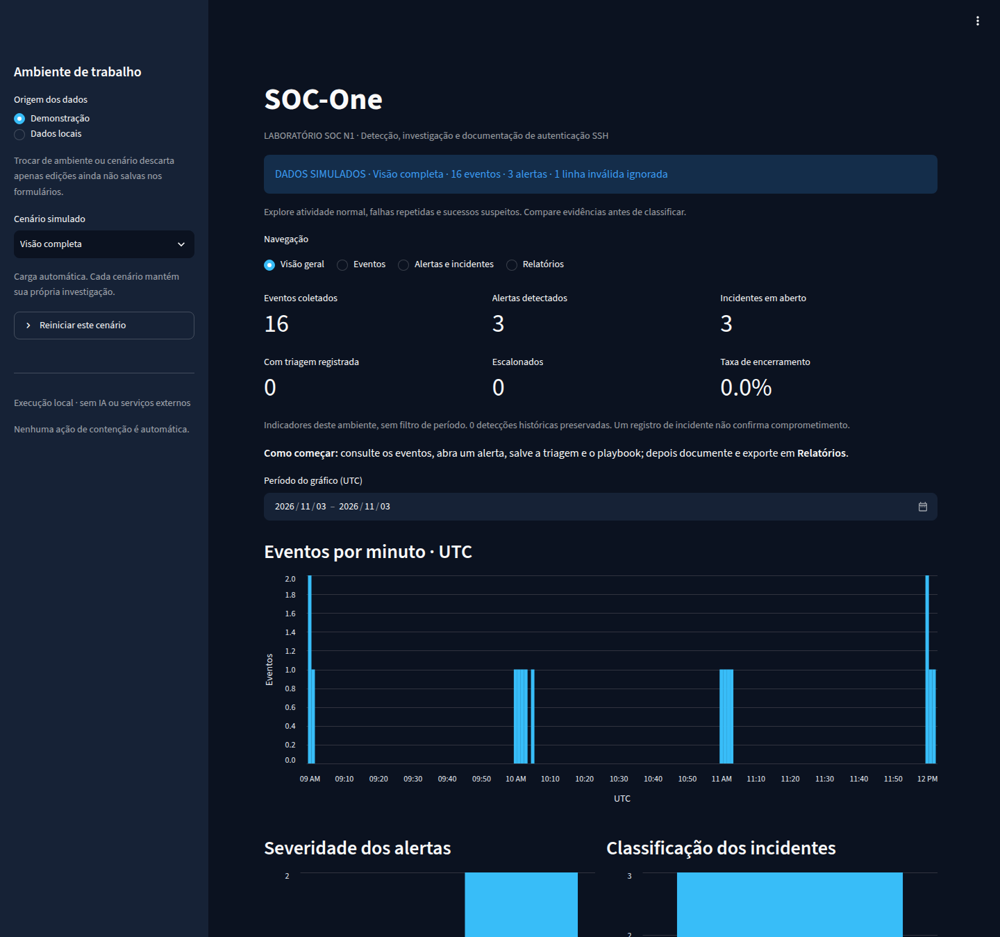
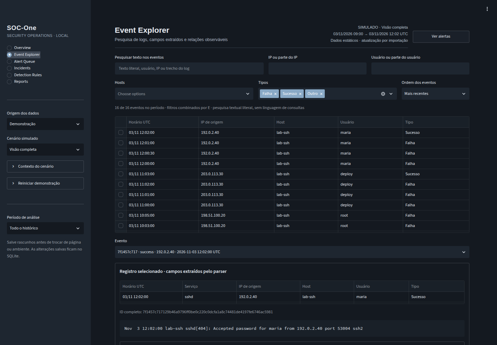
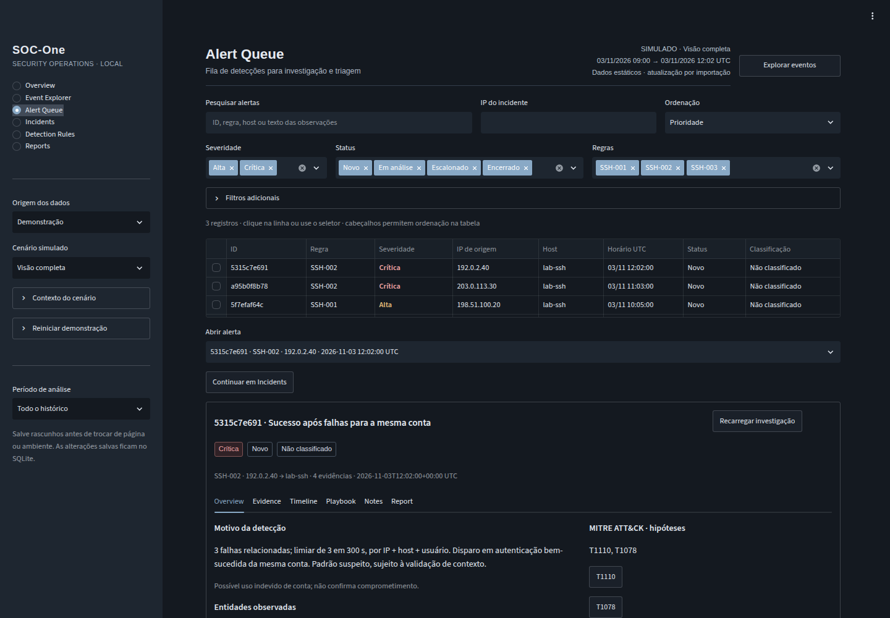
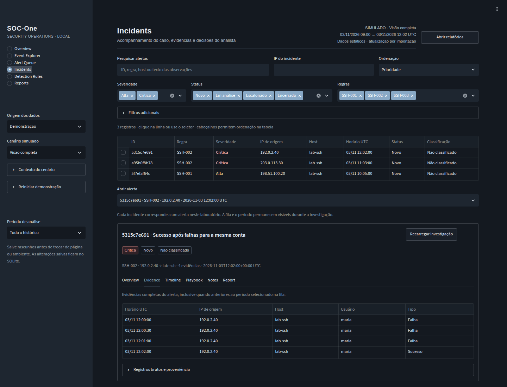
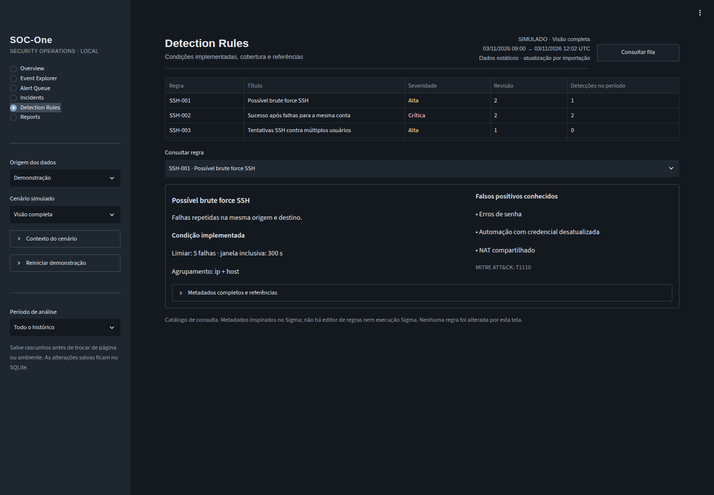
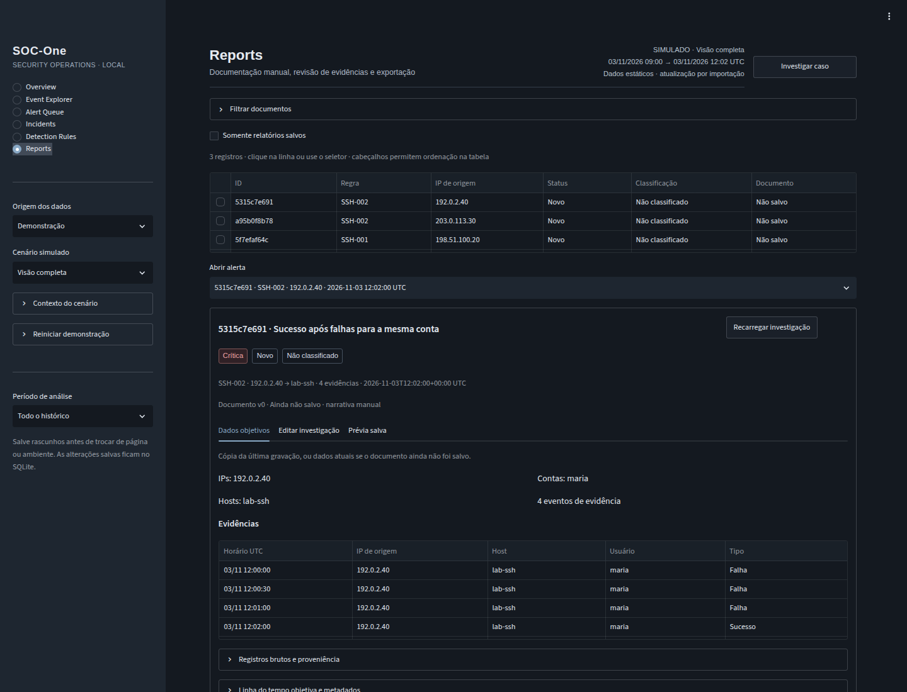

# SOC-One

Laboratório local de Mini SIEM para detecção e investigação de eventos de autenticação SSH. O projeto implementa um fluxo de trabalho SOC N1: coleta de logs, correlação temporal, priorização de alertas, triagem, aplicação de playbooks e documentação de incidentes.

**Tecnologias:** Python, Streamlit, SQLite e pandas; pytest para desenvolvimento. Licença [MIT](LICENSE). O processamento ocorre localmente, sem IA, APIs externas, Docker ou serviços pagos.



Captura real da interface local no Chromium. Não há demonstração hospedada na internet.

## Funcionalidades

- Instalação por scripts Bash e seis cenários fictícios carregados automaticamente, com reinicialização confirmada e dados isolados.
- Importação de arquivos syslog/auth.log em UTF-8, com normalização para UTC, validação de IPv4/IPv6 e contabilização de linhas inválidas.
- Detecção de brute force SSH, sucesso após falhas da mesma conta e tentativas contra múltiplos usuários.
- Metadados de regras inspirados no Sigma e referências a técnicas MITRE ATT&CK.
- Correlação determinística, tratamento de eventos fora de ordem e deduplicação por evento e regra.
- Incidentes com status, classificação, observações, justificativa de encerramento e histórico de alterações.
- Playbooks específicos por regra, com etapas manuais de investigação e encaminhamento N1/N2.
- Relatórios editáveis com narrativa manual, dados objetivos rastreáveis e exportação Markdown/JSON.
- Navegação operacional em seis seções, tabelas selecionáveis, indicadores de triagem e filtros combináveis por período UTC, IP, host, usuário, regra e estado da investigação.
- Persistência SQLite e migração aditiva de bancos da primeira versão.

Cada alerta origina um registro de acompanhamento. A quantidade de incidentes **não indica a quantidade de comprometimentos confirmados**. A classificação depende da investigação manual.

## Instalação e execução em Linux

Requisitos: Python 3.11 ou superior, suporte a `venv` e conexão com o índice de pacotes para a instalação inicial. No Ubuntu, o pacote `python3-venv` fornece o ambiente virtual. Os scripts são executados como usuário comum e recusam `root`; não devem ser chamados com `sudo`.

```bash
git clone https://github.com/ArthurrCorreia/SOC-One.git
cd SOC-One
bash setup.sh
bash run.sh
```

A interface fica disponível em `http://127.0.0.1:8501`. O cenário **Visão completa** abre com dados fictícios, sem configurar servidor SSH ou produzir logs. Para encerrar o servidor, basta usar `Ctrl+C` no terminal.

O `setup.sh` cria ou reutiliza `.venv`, verifica a versão do Python e instala somente as dependências da aplicação. O `run.sh` localiza a pasta do projeto, usa o interpretador desse ambiente e restringe o servidor a `127.0.0.1`. Ambos funcionam por `bash`, sem permissão de execução; podem ser chamados a partir de outro diretório usando o caminho do script.

Para desenvolvimento e testes:

```bash
bash setup.sh --dev
source .venv/bin/activate
python -m pytest -q
```

### Instalação tradicional

```bash
python3 -m venv .venv
source .venv/bin/activate
python -m pip install -r requirements.txt
streamlit run app.py
```

Na alternativa tradicional, os comandos devem ser executados na raiz do repositório. Para instalar também os testes, utiliza-se `python -m pip install -r requirements-dev.txt`.

### Problemas comuns

| Situação | Verificação |
| --- | --- |
| Python não encontrado ou antigo | Disponibilidade de `python3` com versão 3.11 ou superior |
| Falha ao criar `.venv` | Suporte a `python3-venv`/`ensurepip`, permissão de escrita e espaço em disco |
| Ambiente incompleto ou incompatível | Recriação manual de `.venv`; o script não apaga ambientes existentes |
| Falha no download de dependências | Conexão, proxy, certificados e acesso ao índice configurado no pip |
| Porta 8501 ocupada | Encerramento da instância anterior; a aplicação não encerra processos de terceiros |

A aplicação não lê logs do sistema automaticamente e não exige credenciais, APIs, Docker ou privilégios de administrador. A instalação pode acessar o índice de pacotes; o fluxo de investigação não integra serviços externos.

## Demonstração local

Na barra lateral, **Origem dos dados → Demonstração** permite selecionar um cenário. Os eventos fictícios são carregados automaticamente na primeira abertura; selecionar novamente preserva a investigação salva.

| Cenário | Eventos válidos | Alertas esperados |
| --- | --- | --- |
| Visão completa | 16 | 3; uma linha inválida é ignorada |
| Atividade normal | 3 | Nenhum |
| Brute force SSH | 5 | 1 × SSH-001 |
| Autenticação suspeita | 4 | 1 × SSH-002 |
| Falso positivo (exercício) | 4 | 1 × SSH-002; classificação manual |
| Tentativas contra múltiplos usuários | 5 | 1 × SSH-001 e 1 × SSH-003 |

O cenário de falso positivo fornece um contexto explicitamente fictício de erros de digitação reconhecidos pela usuária. Esse contexto não é extraído do log nem inserido automaticamente como conclusão. A classificação e a narrativa permanecem sob responsabilidade do analista.

O roteiro de demonstração é: **Overview → Event Explorer → Alert Queue → Incidents → Reports**. A exploração permite consultar linhas originais; a fila prioriza detecções; a investigação reúne triagem, evidências, linha do tempo, playbook, notas e relatório. **Detection Rules** apresenta as condições implementadas, falsos positivos conhecidos e referências. As alterações devem ser salvas antes de trocar de página ou ambiente.

A identidade visual utiliza grafite, cinza-azulado, tipografia compacta e severidades identificadas por texto e cor. A navegação segue padrões de fila e investigação descritos nas documentações oficiais de [Splunk Mission Control](https://help.splunk.com/en/splunk-enterprise-security-8/user-guide/8.7/mission-control/overview-of-mission-control-in-splunk-enterprise-security), [IBM QRadar](https://www.ibm.com/docs/en/qradar-on-cloud?topic=offenses-offense-investigation) e [Microsoft Sentinel](https://learn.microsoft.com/en-us/azure/sentinel/investigate-incidents), com componentes e identidade próprios.

| Seção | Uso operacional |
| --- | --- |
| Overview | Atividade no período, alertas abertos, prioridades e indicadores de triagem |
| Event Explorer | Pesquisa literal com filtros combinados, campos extraídos, linha bruta e eventos do mesmo IP/host em ±5 minutos |
| Alert Queue | Pesquisa, ordenação por prioridade/data e seleção do alerta sem ocultar a lista |
| Incidents | Overview, Evidence, Timeline, Playbook, Notes e Report no mesmo caso |
| Detection Rules | Consulta das três regras reais; não permite editar regras |
| Reports | Dados objetivos, edição manual, prévia salva e exportação Markdown/JSON |




### Reinicialização segura

Cada cenário mantém sua investigação isolada. A seção **Reiniciar demonstração** exige marcar a confirmação e acionar **Reiniciar demonstração**. A operação apaga triagem, playbook, relatórios e histórico apenas do cenário selecionado, e recarrega seus logs fictícios em uma transação.

Os dados importados e os demais cenários são preservados. Não há opção de reinicialização no ambiente Dados locais. A aplicação verifica a identidade e a versão do cenário antes de reiniciá-lo, impedindo o uso de confirmações desatualizadas.

### Importação de arquivos autorizados

**Origem dos dados → Dados locais** preserva a importação manual de arquivos `.log` ou `.txt` em UTF-8, de até 5 MB. O ambiente fica identificado na interface e nas exportações. Bancos locais de versões anteriores podem conter exemplos já importados; esses registros não são removidos ou reclassificados automaticamente.

Para logs sem ano ou fuso, os parâmetros são informados no formulário. Logs ISO 8601 com fuso mantêm seu instante original. Arquivos RFC3164 que atravessam a virada do ano devem ser separados antes da importação.

O parser reconhece `Failed password`, `Accepted password` e `Accepted publickey` de `sshd`, incluindo `invalid user`. Outros eventos com cabeçalho válido são classificados como `other`. O formato suportado é um subconjunto de syslog/auth.log; não inclui todos os formatos de PAM ou journald.

## Regras e correlação

| Regra | Condição em janela inclusiva de 300 segundos | Agrupamento | Severidade | Referência ATT&CK |
| --- | --- | --- | --- | --- |
| SSH-001 | Pelo menos cinco falhas | IP + host | Alta | T1110 — Brute Force |
| SSH-002 | Sucesso após pelo menos três falhas da mesma conta | IP + host + usuário | Crítica | T1110 e T1078 — Valid Accounts |
| SSH-003 | Pelo menos cinco falhas contra três ou mais usuários distintos | IP + host | Alta | T1110 — Brute Force |

Uma falha às 10:00 participa da janela de 10:05, mas não de 10:05:01. Os eventos são ordenados por horário antes da detecção. Falhas e sucessos no mesmo instante são avaliados com falhas primeiro; a resolução do log não permite comprovar sua ordem real.

As referências ATT&CK indicam hipóteses analíticas. SSH-002 não comprova uso indevido da conta. SSH-003 não confirma *password spraying*, pois os logs não revelam as senhas testadas. NAT, bastions, automações e erros de senha permanecem fontes de falsos positivos.

O catálogo `soc_one/catalog.py` contém identificador, título, revisão, estado experimental, descrição, origem de logs, condições, severidade, tags, falsos positivos e referências. O formato é **inspirado no Sigma**, mas não constitui regras Sigma executáveis ou exportáveis para outros SIEMs.

### Deduplicação e eventos tardios

Eventos são identificados pelo hash do timestamp UTC e da linha sem espaços nas extremidades. Linhas idênticas no mesmo instante são consideradas duplicatas; representações textuais diferentes podem gerar eventos distintos.

Cada ocorrência é identificada pela combinação de regra e evento disparador. Uma sequência de seis falhas dentro da janela gera duas ocorrências SSH-001. Não há agrupamento dessas ocorrências em um único incidente. O processamento deduplica inclusive entradas repetidas na chamada direta do motor.

A importação reavalia os eventos persistidos em ordem temporal. Eventos tardios podem criar alertas e atualizar evidências de alertas existentes, preservando classificação, observações, playbook e relatório. Mudanças na correlação são registradas no histórico.

## Gestão de incidentes e playbooks

Nas páginas **Alert Queue** e **Incidents**, a fila pode ser filtrada por status, severidade, classificação, regra, IP, host e período. A seleção por linha ou seletor apresenta as evidências, o identificador, o motivo da detecção, os metadados da regra e os formulários de acompanhamento. A ordenação por prioridade coloca casos abertos antes dos encerrados, com maior severidade e ocorrências recentes primeiro. O botão de continuidade abre o mesmo caso em Incidents; filtros conflitantes do destino são limpos e os da fila de origem permanecem disponíveis.

Status disponíveis: **Novo**, **Em análise**, **Escalonado** e **Encerrado**. O encerramento exige justificativa. A classificação é independente do status: **Não classificado**, **Verdadeiro positivo**, **Falso positivo** ou **Inconclusivo**. Nenhuma classificação é atribuída automaticamente pelo motor.

Cada regra oferece um checklist com validação de evidências, consulta de contexto, investigação específica e encaminhamento N1/N2. As etapas concluídas são persistidas; alterações, inclusive desmarcações, ficam no histórico. Uma etapa não aplicável pode ser registrada com justificativa nas observações. O checklist não executa contenção, bloqueios ou comunicações externas.

O histórico registra horário UTC, operação e valores anteriores e posteriores para triagem, playbook, relatório e correlação. Operações manuais são atribuídas a **Analista local**, sem autenticação de identidade. A aplicação não oferece edição individual do histórico; a reinicialização confirmada apaga o histórico apenas do cenário simulado. O arquivo SQLite continua modificável por quem tem acesso ao sistema operacional.

Há controle de versão para evitar sobrescritas entre sessões nos formulários de triagem, playbook e relatório. Um conflito exige recarregar a investigação; o estado mais recente é preservado.

## Relatórios de investigação

A página **Reports**, também disponível na aba **Report** de cada incidente, separa **Dados objetivos**, **Editar investigação** e **Prévia salva**. É possível consultar somente documentos salvos e editar os campos:

- Descrição do ocorrido e linha do tempo da investigação.
- Evidências adicionais e indicadores, com suas fontes.
- Impacto observado e análise.
- Ações realizadas e conclusão.

Todos esses campos começam vazios. O sistema não inventa narrativa, impacto, ações, evidências adicionais ou conclusões.

Os dados objetivos são preenchidos a partir dos eventos: intervalo UTC, IPs, hosts, contas, linha do tempo, IDs e linhas de log. A proveniência registra nome do arquivo informado na importação, número da linha, SHA-256 do texto decodificado em UTF-8 e parâmetros de interpretação. Esse hash não equivale necessariamente ao hash dos bytes originais do arquivo, por exemplo quando existe BOM. O nome do arquivo não comprova autenticidade da origem.

Ao salvar, o relatório recebe uma versão e uma cópia dos dados objetivos. Evidências recebidas posteriormente não sobrescrevem essa cópia nem a narrativa; a interface sinaliza que há dados novos. Uma nova gravação atualiza a cópia e preserva os campos manuais não alterados. O histórico mantém os valores anteriores.

A exportação Markdown/JSON inclui a narrativa salva e sua cópia de evidências, além do estado atual da triagem, playbook e histórico, identificados como tal. Antes da primeira gravação, a exportação contém os dados atuais e campos manuais vazios. Texto ainda não salvo no formulário não é exportado.

### Exemplo público de resultado

O [relatório fictício em Markdown](examples/incidente_ficticio.md) e sua [versão JSON](examples/incidente_ficticio.json) demonstram o resultado da exportação. Contêm somente logs simulados e narrativa identificada como exercício. Não são evidências de um incidente real.

O exemplo pode ser regenerado sem acessar bancos locais:

```bash
source .venv/bin/activate
python -m examples.generate_report
```



## Indicadores e filtros

O topo de Overview apresenta eventos, alertas abertos, casos em análise, críticos abertos e escalonados. Abaixo estão a série temporal, severidade dos alertas abertos, frequência das regras e incidentes recentes. Uma seção expansível preserva contagens de triagem, encerramento, status, classificação e os IPs com mais falhas. Detecções históricas não compõem essas métricas.

O **Período de análise** na barra lateral controla todas as seções: histórico completo ou intervalo personalizado, inclusive nos limites, em UTC. Eventos são filtrados pelo timestamp; alertas, pelo horário do disparo. As evidências completas do caso permanecem disponíveis, mesmo quando anteriores ao período da fila. Intervalos incompletos ou invertidos impedem a consulta até serem corrigidos.

A pesquisa usa texto literal, sem SPL/AQL. Os filtros de cada seção são combinados por E e preservados durante a navegação no mesmo ambiente. A troca de cenário limpa filtros e rascunhos para evitar misturar investigações. Relações no Event Explorer usam o histórico do ambiente, mesmo IP e host, em até cinco minutos antes/depois; não comprovam causalidade.




## Arquitetura

```text
Arquivo autorizado
    → parser → eventos normalizados + proveniência
    → motor de correlação + catálogo de regras
    → SQLite: alertas, incidentes, histórico, playbooks e relatórios
    → Streamlit: investigação manual e exportação Markdown/JSON
```

| Componente | Responsabilidade |
| --- | --- |
| `soc_one/models.py` | Modelos de eventos e alertas |
| `soc_one/parser.py` | Parsing, validação e normalização UTC |
| `soc_one/catalog.py` | Metadados e parâmetros das regras |
| `soc_one/rules.py` | Correlação temporal determinística |
| `soc_one/migrations.py` | Evolução aditiva do esquema SQLite |
| `soc_one/storage.py` | Transações, histórico, proveniência e controle de versões |
| `soc_one/playbooks.py` | Procedimentos de investigação N1/N2 |
| `soc_one/reports.py` | Dados objetivos e exportação Markdown |
| `soc_one/analytics.py` | Métricas operacionais |
| `soc_one/ui.py` | Investigação, formulários, evidências e relatório |
| `soc_one/ui_components.py` | Cabeçalhos, tabelas, indicadores e componentes visuais comuns |
| `soc_one/ui_pages.py` | Composição das seis seções e navegação entre casos |
| `soc_one/viewmodels.py` | Filtros, prioridade e contexto para apresentação, sem alterar registros |
| `app.py` | Navegação, escolha do ambiente e importação |
| `soc_one/demo.py` | Cenários isolados e reinicialização confirmada |
| `setup.sh` / `run.sh` | Instalação e execução local |
| `examples/` | Relatório fictício e gerador com banco temporário |
| `assets/` | Capturas reais da interface com dados simulados |
| `samples/` | Logs fictícios para demonstração |
| `tests/` | Testes do núcleo, migração e interface |

## Atualização de bancos da primeira versão

A migração ocorre automaticamente ao abrir o banco. Antes de atualizar a aplicação, recomenda-se interromper sua execução e realizar uma cópia de segurança dos dados persistidos.

Tabelas e colunas são adicionadas em transação. Eventos, observações e justificativas existentes são preservados. O estado encontrado no banco legado recebe um registro de migração; alterações anteriores à existência do histórico não são reconstruídas.

Alertas legados são reavaliados pela nova correlação por host e conta. Os que deixarem de atender às regras são marcados como históricos, sem remoção de incidentes ou evidências. Eventos legados sem proveniência de importação são identificados explicitamente como tal. A reimportação do arquivo correspondente pode complementar a proveniência.

## Testes e validação

```bash
bash setup.sh --dev
source .venv/bin/activate
python -m pytest -q
python -m compileall -q app.py soc_one examples
python -m pip check
bash -n setup.sh run.sh
```

A suíte verifica parsing, limites temporais, ordenação, isolamento entre hosts e contas, múltiplos usuários, deduplicação, persistência, migração, histórico, classificação, playbooks, concorrência de edição, relatórios e proveniência. Streamlit AppTest exercita os formulários em bancos temporários.

A cobertura inclui os seis cenários simulados, navegação, filtros combinados, período inclusivo, continuidade do caso, formulários, persistência, conflitos de edição e proveniência após chegada tardia de eventos. Os testes utilizam dados fictícios e ambientes temporários. A versão mínima do Streamlit é 1.66, necessária para as opções nativas de espaçamento do tema.

## Limitações

O SOC-One é um laboratório educacional, não um SIEM de produção. O histórico é reprocessado em memória a cada importação, com persistência local adequada a conjuntos pequenos. Não há coleta contínua, retenção automática, paginação, autenticação multiusuário, trilha inviolável, criptografia do banco ou resposta automática. A interface prioriza desktop/notebook; as tabelas usam rolagem interna para conjuntos maiores, e textos extensos podem exigir expansão ou consulta aos detalhes. Rascunhos devem ser salvos antes de mudar de seção ou ambiente.

As correlações consideram a origem IP e o hostname presente no log, sem resolução de aliases ou comprovação de causalidade. A deduplicação pode colapsar eventos realmente distintos com linhas idênticas no mesmo instante. Ocorrências sucessivas de uma regra não são agregadas em um único caso.

Relatórios e logs podem conter informações sensíveis. A aplicação não identifica automaticamente dados sensíveis em exportações. Os exemplos publicados em `samples/` e `examples/` utilizam somente dados fictícios.

## Referências

- [MITRE ATT&CK — Brute Force (T1110)](https://attack.mitre.org/techniques/T1110/).
- [MITRE ATT&CK — Valid Accounts (T1078)](https://attack.mitre.org/techniques/T1078/).
- [Sigma Rules Specification](https://sigmahq.io/sigma-specification/specification/sigma-rules-specification.html).

Repositório: [ArthurrCorreia/SOC-One](https://github.com/ArthurrCorreia/SOC-One).

## Licença

Distribuído sob a [licença MIT](LICENSE).
